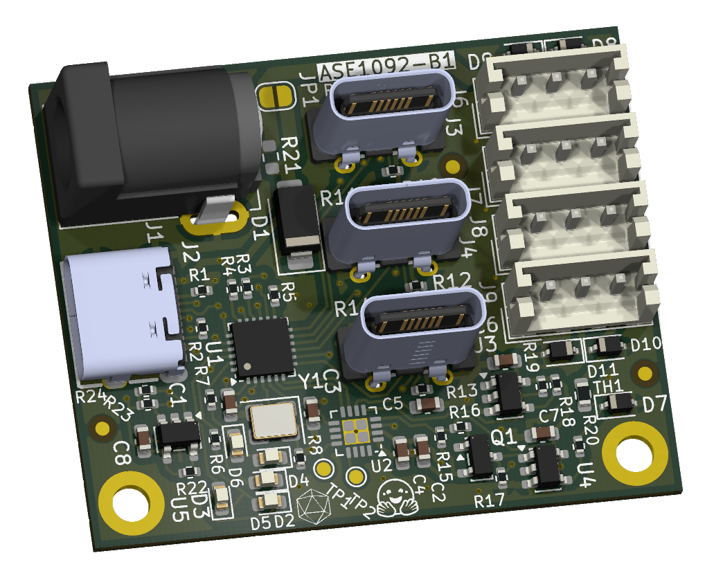

# "elec_saint-marcellin" Electronic Board

"elec_saint-marcellin" is a USB 2.0 hub with USB type C connectors and a Dynamixel converter.

## Releases
| Release | Date       | Designer | Check  | Comments                               |
|---------|------------|----------|--------|----------------------------------------|
| A1      | 26/06/2025 | EB       | SN     | Initial drawing                        |
| B1      | 23/11/2026 | EB       | SN     |[fixed] Dynamixel-X connectors were 180 deg |

## Basically
 - Designed with KiCAD 10.
